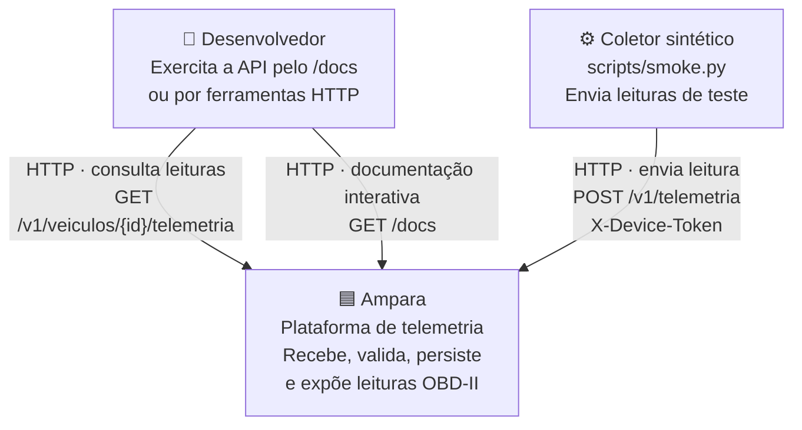
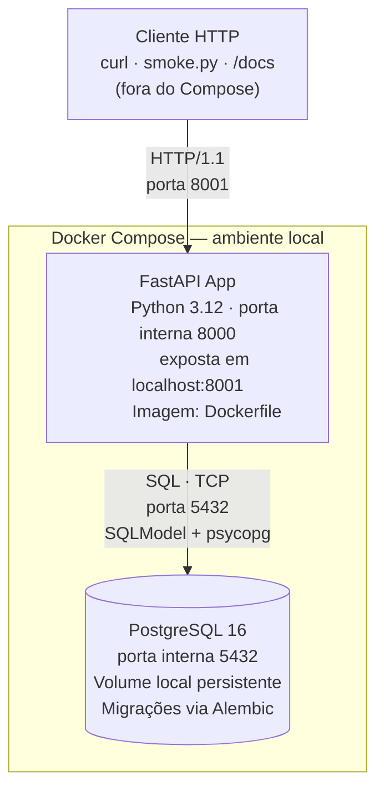
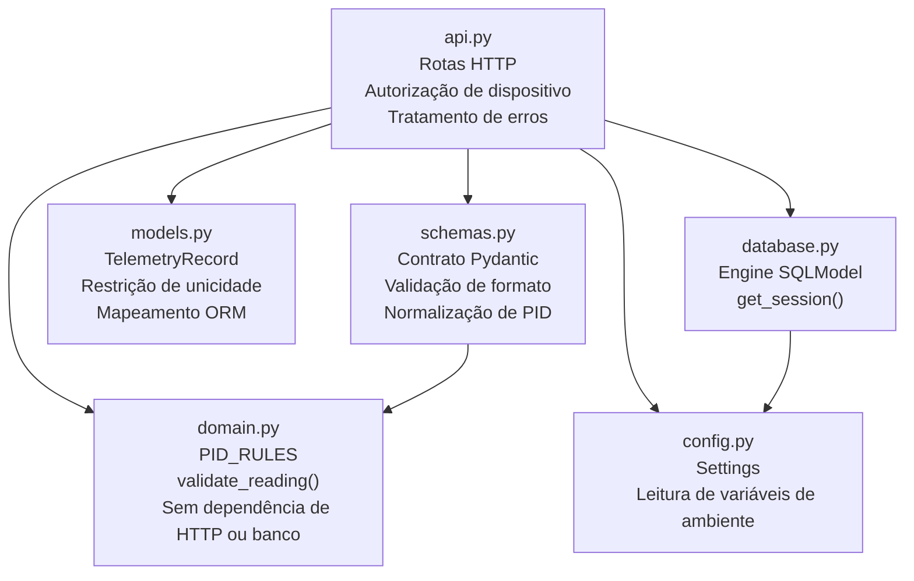

# Arquitetura C4 — Ampara

Diagramas de contexto, containers e componentes correspondentes à implementação
atual. Atualizar sempre que uma peça executável ou fronteira de módulo mudar.
Decisões que motivam esta estrutura estão em
[`adr/0002-monolito-modular.md`](adr/0002-monolito-modular.md).

---

## C1 — Contexto

Mostra quem interage com o sistema e o que está fora dele.

**Fora do escopo atual:** veículo físico com adaptador ELM327, usuário final,
frontend, modelo preditivo, fila de mensagens, múltiplos tenants.

---

## C2 — Containers

Mostra as peças executáveis e como se comunicam. "Container" é qualquer unidade
implantável — não necessariamente Docker.

**Configuração:** variáveis de ambiente em `.env` (ignorado pelo Git).
`.env.example` documenta as chaves sem valores reais.

---

## C3 — Componentes

Mostra os módulos dentro do container FastAPI e a direção das dependências.
Dependências apontam de fora para dentro: `api.py` conhece tudo; `domain.py`
não conhece nada do projeto além de si mesmo.

**Regra de dependência:** nenhuma seta sobe de `domain.py` ou `models.py`
para outros módulos internos. Qualquer mudança que quebre essa direção requer
um novo ADR antes de ser aceita.
